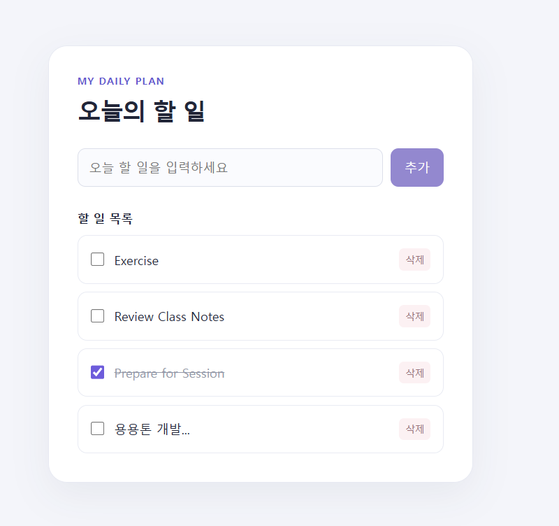
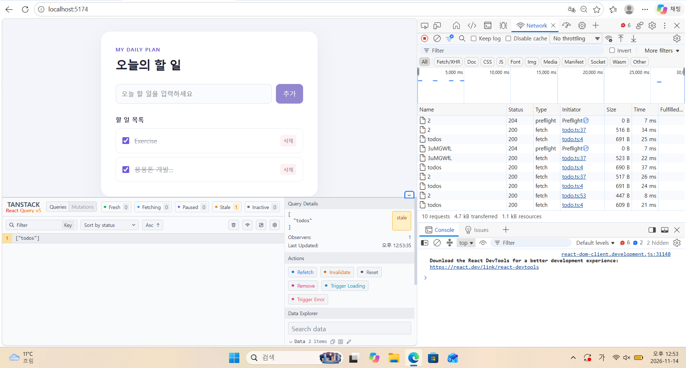

# TanStack Query 실습 - Todo 앱

TanStack Query를 배우면서 만든 할 일(Todo) 앱입니다.
React, TypeScript, Vite를 사용했고 서버는 `server/db.json`으로 만든 가짜 API(`http://localhost:3000`)입니다.

## 실행 방법

```bash
npm install
npm run dev
```

서버도 따로 켜야 합니다.

```bash
npx json-server@0.17.4 --watch server/db.json --port 3000
```

---

## 1번 과제: 삭제 기능

### 사용한 기능

- `useMutation`: 서버에 데이터를 바꾸는 요청(추가, 수정, 삭제)을 보낼 때 쓰는 기능입니다.
- `setQueryData`: 서버에 다시 요청하지 않고, 이미 저장된 캐시 데이터를 내가 직접 고치는 기능입니다.

원래는 삭제하고 나서 `invalidateQueries()`로 목록을 다시 불러오는 방법도 있습니다.
하지만 이번 과제에서는 `setQueryData`를 써서 목록을 다시 불러오지 않고 화면을 바꿨습니다.

### 구현한 코드

**1) 삭제 요청 보내기 (`src/api/todo.ts`)**

```ts
export const deleteTodo = async (id: string): Promise<string> => {
  const response = await fetch(`http://localhost:3000/todos/${id}`, {
    method: "DELETE",
  });

  if (!response.ok) {
    throw new Error("할 일을 삭제하지 못했습니다.");
  }

  return id;
};
```

- `DELETE` 방식으로 해당 id의 할 일을 지우라고 서버에 요청합니다.
- 성공하면 지운 id를 돌려줍니다. 이 id를 아래에서 사용합니다.

**2) 삭제 성공 후 캐시 고치기 (`src/components/TodoList.tsx`)**

```tsx
const { mutate: deleteTodoMutate } = useMutation({
  mutationFn: deleteTodo,

  onSuccess: async (deletedId) => {
    await queryClient.cancelQueries({ queryKey: ["todos"] });

    queryClient.setQueryData<Todo[]>(["todos"], (prevTodos) => {
      return prevTodos?.filter((todo) => todo.id !== deletedId);
    });
  },
});
```

- `mutationFn`에 위에서 만든 `deleteTodo`를 넣었습니다.
- 삭제가 성공하면 `onSuccess`가 실행됩니다.
- `filter`로 지운 id가 아닌 할 일만 남겨서 캐시를 바꿉니다. 그러면 화면에서도 바로 사라집니다.
- `cancelQueries`는 진행 중인 조회가 있을 때, 그 결과가 삭제 전 목록으로 캐시를 덮어쓰지 않게 막아 줍니다.

### 결과

- 삭제 버튼을 누르면 그 할 일이 화면에서 사라집니다.
- `server/db.json`에서도 지워집니다.
- 새로고침해도 다시 나타나지 않습니다.
- 삭제 후에 GET 요청이 추가로 가지 않습니다.

---

## 2번 과제: 프리페칭 (Prefetching)

### 사용한 기능

- `prefetchQuery`: 사용자가 데이터를 필요로 하기 전에 미리 가져와서 캐시에 저장해 두는 기능입니다.
- `queryOptions`: 쿼리 설정(`queryKey`, `queryFn`, `staleTime`)을 한 곳에 모아 두고 여러 곳에서 같이 쓰게 해 주는 기능입니다.

화면이 그려지기 전에 데이터를 미리 요청하기 때문에, 화면이 뜰 때 이미 데이터가 도착했거나 도착하는 중입니다.
그래서 "로딩 중..." 이 보이는 시간이 줄어듭니다.

### 구현한 코드

**1) 설정을 따로 빼기 (`src/hooks/useTodosData.ts`)**

```ts
export const todosQueryOptions = queryOptions({
  queryKey: ["todos"],
  queryFn: fetchTodos,
  staleTime: 5000,
});

export const useTodosData = () => {
  return useQuery(todosQueryOptions);
};
```

- 같은 설정을 `useQuery`와 `prefetchQuery`에서 같이 쓰려고 `todosQueryOptions`로 분리했습니다.
- `queryKey`가 같아야 미리 가져온 데이터를 화면에서 그대로 쓸 수 있습니다.

**2) 앱이 시작될 때 미리 가져오기 (`src/main.tsx`)**

```tsx
const queryClient = new QueryClient();

queryClient.prefetchQuery(todosQueryOptions);
```

- `QueryClient`를 만들자마자 할 일 목록을 미리 요청합니다.
- 이후 `App`에서 `useTodosData()`를 쓰면 이미 받아 둔 데이터를 사용합니다.

### 결과

- 페이지를 열면 `/todos` GET 요청이 한 번만 갑니다. 미리 가져오는 요청과 화면의 요청이 하나로 합쳐지기 때문입니다.

---

## 실행 화면




위 화면에서 `삭제` 버튼을 누르면 해당 할 일이 목록에서 사라집니다.
